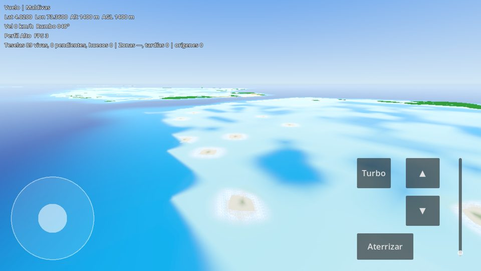
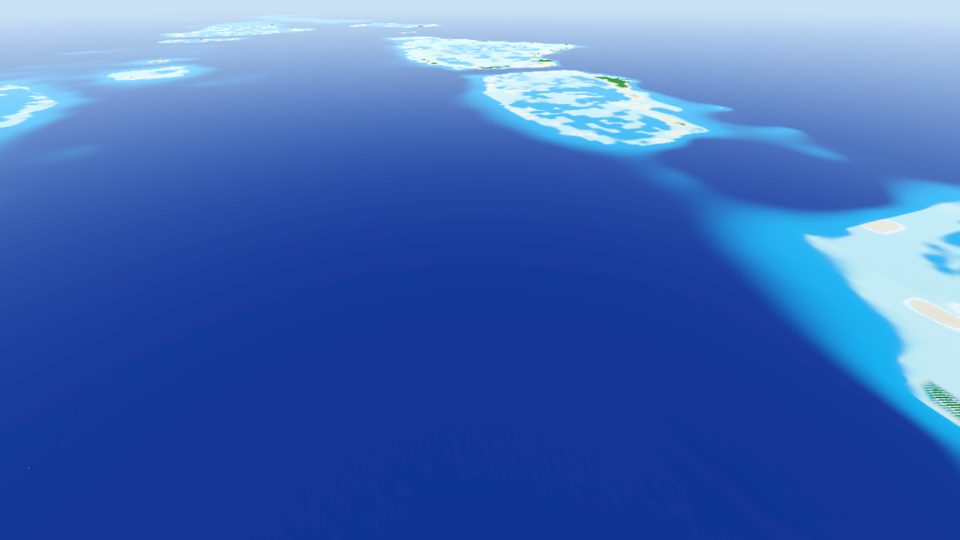
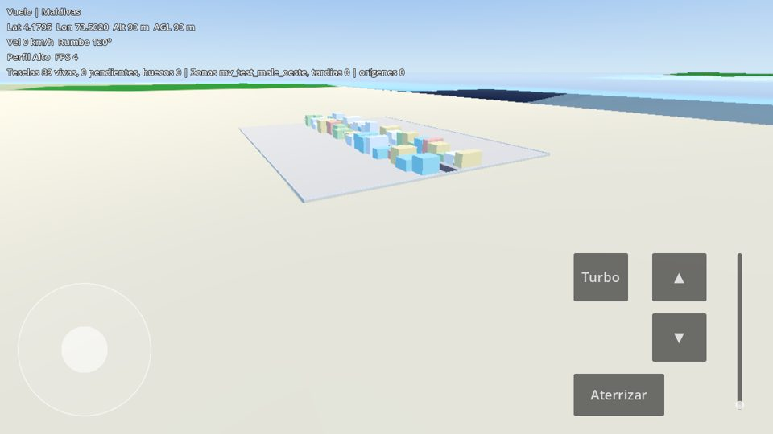
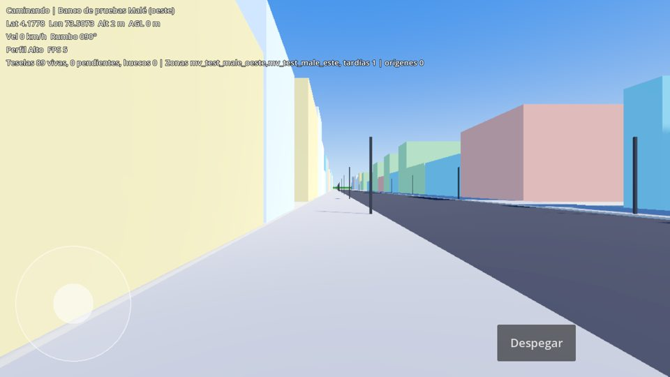

# Vuelo Mundo

Juego para celular (Android) hecho en **Godot 4.7** con el renderer **Mobile**: un vuelo
continuo en primera persona sobre lugares reales, con geografía fiel (relieve, costas,
profundidad del mar y aspecto del agua) a partir de **datos abiertos**. El jugador aterriza
y camina las calles de los micro-mapas. No hay portales, saltos ni menús de viaje: si un
lugar no está modelado, no se llega volando.

La idea: que cualquiera pueda recorrer volando su lugar favorito del planeta, aunque no
pueda viajar. El primer país es **Maldivas**.

> Estado: **hito 1**. Capa planetaria tosca + detalle regional de Maldivas, coordenadas
> globales, índice de zonas, streaming, avatar que vuela/aterriza/camina/despega, perfiles
> gráficos, shader de agua y pipeline de datos. Los dos micro-mapas de Malé incluidos son
> **bancos de prueba** (geometría genérica para probar aterrizaje, caminata y cruce de
> borde), **no** una recreación de Malé. Los micro-mapas reales vienen en el próximo hito.

| Vuelo sobre los atolones (perfil Alto) | Desde 9 km |
|---|---|
|  |  |
| **Banco de pruebas desde el aire** | **Caminando en el banco de pruebas** |
|  |  |

Las capturas se generaron con render por software (Mesa lavapipe en Xvfb), así que los FPS
que muestran no representan un celular.

---

## Arquitectura

### 1. Un solo sistema de coordenadas global (`scripts/core/geo.gd`)

- Proyección **Mercator esférica EPSG:3857** (R = 6 378 137 m). Coordenada global =
  `(e, n)` en metros de esa proyección + altitud `up`. **Norte siempre = −Z** en Godot,
  misma escala y mismo norte en todo el proyecto.
- Es **conforme**: no deforma formas localmente. La escala varía con la latitud por
  `k = 1/cos(lat) = cosh(n/R)`; alturas, velocidades del avatar y escenas se multiplican
  por `k` para conservar proporciones reales (Maldivas: k ≈ 1.002; París: k ≈ 1.52).
  Así el Coliseo o la Torre Eiffel podrán modelarse en metros reales.
- Límite: ±85.05° de latitud (como toda Mercator). El antimeridiano se cruza sin corte
  (`Geo.wrap_e`/`delta_e`).
- **Precisión:** GDScript usa `float` de 64 bits, y las coordenadas globales se guardan
  siempre así (`GlobalPos`), nunca en `Vector3` (32 bits). `WorldRoot` mantiene un
  **origen de render** y lo desplaza cuando el avatar se aleja más de 2048 m: todo queda
  cerca de (0,0,0) para el motor y no hace falta compilar Godot con doble precisión.

### 2. Cuadrícula de teselas (planeta tosco + detalle)

- Nivel L → 2^L × 2^L teselas de `2πR / 2^L` m. `i` crece al este, `j` al sur, y el
  origen de cada tesela es su esquina NO.
- **L6 (planeta tosco / conector):** 4096 teselas de ~626 km, 65×65 muestras (~9.8 km)
  desde ETOPO 2022 60" + máscara de tierra Natural Earth. Unos 23 MB.
- **L8 (detalle regional Maldivas):** 96 teselas de ~156 km, 257×257 muestras (~611 m)
  desde ETOPO 2022 15", con costa e arrecifes de OpenStreetMap. Unos 8 MB. Cubre teselas
  L6 **completas**, así el cambio tosco → detalle nunca deja huecos.
- Formato `VMT1` (`pipeline/vm_common.py`, `scripts/streaming/tile_builder.gd`):
  cabecera de 36 bytes y, comprimidas con zlib, alturas int16 más la máscara de tierra.
- Las teselas vecinas comparten exactamente las muestras del borde, sin escalones (hay
  test para esto). Las polleras (skirts) tapan las grietas entre L6 y L8.

### 3. Zonas e índice (`data/zone_index.json`, `scripts/core/zone_*.gd`)

- Cada zona guarda **solo origen (esquina NO) y tamaño**, en metros globales, y traduce
  la posición global del avatar a su espacio local (`ZoneInfo.global_to_local`).
- El índice mínimo tiene: `id`, `origin`, `size`, `neighbors`, `landing` y además `kind`
  (país o sitio), `scene`, `available` y `local_scale`. Se genera con
  `pipeline/make_zone_index.py` a partir de lon/lat legibles.
- Hoy contiene el país `MV` (Maldivas), dos vecinos todavía no disponibles (`IN`, `LK`) y
  dos micro-mapas de prueba adyacentes en Malé (`mv_test_male_oeste`, `mv_test_male_este`).
- **Dos escenas solo se tocan si comparten origen de referencia y escala:** los sitios de
  un país usan la `k` fija del país (`local_scale`), y el borde A|B coincide al milímetro.
- Bajo cada micro-mapa el pipeline baja el terreno a 1 m, así el suelo caminable siempre
  queda encima del conector.

### 4. Streaming (`scripts/streaming/`)

- `StreamMath` concentra las reglas puras (testeadas), que **no dependen del perfil gráfico**:
  - banda de aviso = `400 m + velocidad × 8 s` (tope de 120 km): se ensancha con la velocidad;
  - la petición lleva coordenada global, rumbo y altitud; se piden las zonas dentro de la
    banda (distancia 3D), las que están sobre la trayectoria prevista, y los vecinos y
    diagonales del sitio actual;
  - siempre hay **mínimo dos zonas vivas** dentro de un sitio con vecinos;
  - la descarga tiene histéresis (`banda × 1.5 + 1 km`).
- `TileStreamer`: anillo de teselas L6 alrededor del avatar y de su posición prevista
  (radio mínimo 1, o sea 3×3). Cerca de una tesela con detalle pide sus 16 hijas L8 y
  oculta la tosca recién cuando están **todas** listas. La construcción (lectura,
  descompresión, malla, colisión e imagen de profundidad) corre en `WorkerThreadPool`; el
  hilo principal solo agrega nodos, con un presupuesto por cuadro. No hay pantalla de carga
  ni bloqueo de control. Solo el arranque arma el 3×3 inicial de forma síncrona.
- `ZoneStreamer`: carga los micro-mapas con `ResourceLoader.load_threaded_request` y los
  instancia (memoria + GPU) apenas están listos, antes del cruce. Si alguna vez se cruza a
  una zona que no estaba lista, lo cuenta como **cruce tardío** (la prueba falla).

### 5. Avatar (`scripts/avatar/avatar.gd`)

Un solo `CharacterBody3D`:
- **Aire:** primera persona; acelerar, girar, subir y bajar. Velocidad máxima 340 m/s, o
  1500 m/s con turbo para cruzar océanos. No se hunde en el mar.
- **Aterrizaje:** un rayo al suelo confirma contacto con una superficie **caminable**
  (capa física 2: malla y colisión a escala de calle). Entonces la velocidad pasa a
  caminata (1.6 m/s, 4.5 m/s corriendo) y la cámara baja a 1.65 m. El terreno tosco
  (capa 1) es sólido pero **no** caminable: el heightmap no alcanza para caminar.
- **Despegue:** invierte el cambio. Si al caminar se acaba la malla caminable, el avatar
  vuelve al aire.

### 6. Perfiles gráficos (`scripts/quality/quality_manager.gd`, `data/device_profiles.json`)

- Detección automática con `OS.get_model_name()`, `RenderingServer.get_video_adapter_name()`
  y `OS.get_memory_info()`, comparando contra una tabla de expresiones regulares (Adreno,
  Mali, Xclipse, modelos Samsung/Pixel…) que da Bajo, Medio, Alto o Ultra, con topes por RAM.
- Si el equipo no está en la tabla, la pantalla de inicio corre una **prueba de 3 s** sin
  vsync y elige el perfil según los FPS. El perfil detectado se muestra y se puede cambiar
  (queda guardado en `user://settings.cfg`).
- Cada perfil cambia la distancia de niebla, la escala de render, MSAA, sombras, la
  resolución de malla y de textura de profundidad del detalle, y el radio de carga.
  **Nunca** cambia la regla del vecino precargado.

### 7. Agua (`shaders/water.gdshader`)

- Profundidad real por tesela, horneada desde ETOPO/GEBCO en una textura `RF`. El color
  depende de la profundidad y de la latitud: un atolón tropical no se ve igual que un
  puerto templado o polar.
- Espuma en la orilla, transparencia en aguas bajas (se ve el fondo de arena de coral del
  shader de terreno) y olas animadas. Las olas usan coordenadas **globales** periódicas
  (`world_origin_mod`), así el desplazamiento de origen no hace saltar el patrón.

---

## Estructura

```
project.godot            renderer Mobile, autoloads, capas físicas, shader global
export_presets.cfg       preset "Android arm64"
scenes/                  boot.tscn (inicio y perfil), main.tscn, zones/*.tscn (micro-mapas)
scripts/core/            geo, global_pos, world_root, zone_info, zone_index, input_setup
scripts/streaming/       stream_math, tile_builder, tile_streamer, zone_streamer
scripts/avatar/          avatar
scripts/quality/         quality_manager
scripts/ui/              boot, hud, virtual_stick
scripts/tools/autotest.gd  recorrido automático de verificación
shaders/                 terrain.gdshader, water.gdshader
data/                    zone_index.json, device_profiles.json, tiles/ (L6, L8, manifest)
pipeline/                scripts Python de datos abiertos
tests/                   pruebas GUT
tools/                   gen_test_zones.gd, run_tests.sh, screenshot.sh, export_android.sh
addons/gut/              GUT 9.7.1
```

## Cómo correrlo

Requisitos: Godot **4.7.2** estable.

```bash
godot --path . --editor             # abrir en el editor
godot --path .                      # jugar en escritorio (pantalla de inicio -> Despegar)
godot --path . -- --auto --start=4.02,73.36,1400,40   # directo al vuelo
```

Argumentos (después de `--`): `--start=lat,lon,alt,rumbo`, `--speed=m/s`, `--pitch=grados`,
`--profile=low|medium|high|ultra`, `--hide-hud`, `--screenshot=ruta.png`, `--autotest`,
`--quit-after=s`.

**Controles en escritorio:** W/S acelerar/frenar · A/D girar · E/Espacio subir ·
Q/Ctrl bajar · B turbo · L aterrizar · T despegar · clic derecho + mouse para mirar.
Caminando: WASD para moverse, Shift para correr.
**En el celular:** joystick a la izquierda (girar/subir en vuelo, moverse caminando),
acelerador vertical, botones ▲/▼, Turbo y Aterrizar/Despegar; arrastrando en la mitad
derecha se mira alrededor.

### Pruebas

```bash
tools/run_tests.sh          # gdlint + 25 pruebas GUT (coordenadas, zonas, banda, teselas)
tools/run_tests.sh --full   # + recorrido automático headless (~4 min)
tools/screenshot.sh /tmp/vuelo.png --profile=high --start=4.02,73.36,1400,40 --pitch=-15
```

El recorrido automático (`--autotest`) arranca al oeste de la región de detalle a
1500 m/s (×6 de tiempo) y entra al detalle de Maldivas. Después se aproxima a Malé,
aterriza en el banco de pruebas A, camina hacia el este cruzando el borde A → B, despega
y se aleja. Falla si hay huecos en el terreno, cruces tardíos, escalones de más de 5 cm
al caminar o si las zonas no se descargan.

### Pipeline de datos

```bash
cd pipeline
python3 fetch_sources.py      # descarga ETOPO 2022 60"/15", Natural Earth 10m, OSM Maldivas
python3 make_zone_index.py    # data/zone_index.json
python3 fetch_aca.py          # Allen Coral Atlas (geomorfología, CC BY 4.0) por WFS público
python3 bake_tiles.py         # data/tiles/L6 (planeta) + L8 (Maldivas, con lagunas corregidas)
python3 fetch_assets.py       # texturas PBR + HDRI CC0 de Poly Haven -> assets/
python3 make_generated_textures.py  # palmera, bandera, cartel publicitario (obra propia)
python3 make_male.py          # Malé desde OSM -> data/sites/ (capas intermedias, no versionadas)
python3 make_zone_index.py
cd .. && godot --headless --script res://tools/gen_male.gd   # -> scenes/zones/mv_male_*.scn
```

### Malé real

La isla entera es caminable, en dos zonas (`mv_male_oeste` / `mv_male_este`, borde común en
73.515° E). Sale de OpenStreetMap: todas las calles y callejones con veredas, cebras en los
cruces, muro de costa, Playa Artificial, muelles, escolleras, edificios OSM (981) y, donde OSM
no tiene edificios cargados, lotes procedurales dentro de las manzanas reales (6860, marcados
como procedurales en `meta.json`). Hitos: Centro Islámico (cúpula dorada y alminar, diseño
propio), Hukuru Miskiy (piedra de coral), Plaza de la República con la bandera. Métricas en
`data/sites/male_metrics.json` (66 km de vías OSM, 2,08 km² de suelo caminable).

**Carteles publicitarios:** 648 `AdSlot` en fachadas de locales sobre calles comerciales,
con id estable (`data/ad_slots.json`) y textura intercambiable:
`AdSlot.assign(get_tree(), "mv_male_oeste_ad_000", textura)`.

Los datos crudos (~520 MB) van a `../vuelo-mundo-data/raw` y no se versionan (podés
cambiar la ruta con `VM_RAW` y `VM_WORK`). Las teselas horneadas (~31 MB) sí están en el
repositorio para que el proyecto corra recién clonado.

### Android

Esta versión es **solo Android** (arm64-v8a). Hace falta:
- OpenJDK 17, Android SDK (platform-tools, build-tools 35.0.1+, platform 35/36,
  cmdline-tools, CMake 3.10.2, NDK r28b) y las plantillas de exportación de Godot 4.7.2;
- en *Editor → Configuración del editor → Exportar → Android*: `Java SDK Path`,
  `Android SDK Path` y el keystore de depuración.

```bash
tools/export_android.sh       # build/vuelo-mundo-debug.apk (~60 MB, firmado debug)
```

El APK se exporta sin errores, pero **todavía no se probó en un teléfono real**.

---

## Pendiente / problemas conocidos

- **Malé: aspecto.** Es reconocible por el trazado, los hitos y la densidad, pero está lejos
  de la calidad de un juego comercial: edificios como prismas con ventanas procedurales (sin
  balcones, aleros, cables, vehículos, gente), sin iluminación horneada (LightmapGI no se
  horneó: necesita GPU), sin modelos reales de los hitos. Las alturas son inventadas donde OSM
  no las tiene (casi siempre). Faltan postes de luz, señales y mobiliario.
- **Lotes procedurales:** OSM tiene ~1000 edificios en Malé; el resto se rellena. Puede haber
  edificios encima de pasajes que OSM no tiene mapeados.
- **Lagunas:** corregidas con el Allen Coral Atlas + profundidades publicadas (modelo, no
  sondeos: el fondo es una rampa suave hasta 50-80 m según la latitud). A 611 m por muestra
  los faros chicos quedan como manchas.
- **Agua de Malé vs. conector:** dentro del rectángulo de las zonas el agua es propia; en el
  borde puede verse una línea de color.
- **Escala Mercator:** `k` varía con la latitud. El avatar y las escenas la compensan,
  pero el conector tosco cerca de los polos (más de 75°) se ve estirado y no hay vuelo por
  encima de 85°.
- Mar Caspio y otras depresiones: el agua se dibuja a nivel 0 (no a −28 m).
- Al cruzar el antimeridiano el patrón de olas cambia de fase una vez (no se nota a la
  distancia).
- El color del terreno sale de la altura, la pendiente y la latitud: todavía no hay
  cobertura del suelo real.
- No hay controles de cámara libre en vuelo más allá de mirar arrastrando; no hay sonido.
- **Rendimiento de streaming:** el cambio tosco↔detalle ya no tira (peor cuadro de cambio
  6,9 ms en headless; la prueba automática lo afirma, < 33 ms). Las tareas en hilo se limitan
  por perfil y la colisión se arma con presupuesto por cuadro. Quedan ~1 de cada 10 000
  actualizaciones de 10-16 ms en secciones triviales: en la máquina de pruebas lo atribuyo al
  SO/VM, sin confirmar en un teléfono. Shaders: Godot 4.7 precompila pipelines (ubershaders);
  no hay paso extra de precalentamiento.
- Al caminar se mide una variación vertical de hasta ~8 mm por paso físico (asentamiento
  de la cápsula). Está por debajo del umbral de escalón de 5 cm.
- Falta medir rendimiento en equipos reales y ajustar la tabla de dispositivos.
